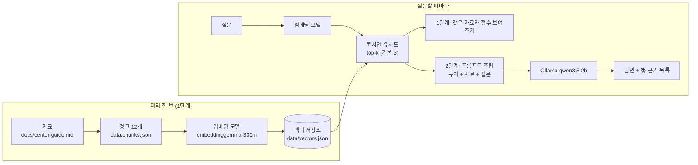

# 피지컬그라운드 안내 챗봇: 내 PC에서 끝나는 RAG 2단계

경기 용인의 크로스핏·기능성 트레이닝 센터 **피지컬그라운드**에 처음 오려는 사람(운동 초보가 많음)과 기존 회원이 체험 비용, 이용 요금, 수업 시간표, 위치·주차, 등록·홀딩 규정을 물으면 **센터가 공개한 자료와 운영자가 확인한 정보**를 근거로 답하는 챗봇입니다.

- **답하는 것**: 체험·이용 요금, 크로스핏·다이어트 운동초보 수업 시간, 주말 운영, 위치·주차·영업시간, 등록·결제, 홀딩, 1:1 트레이닝, 준비물, 연락처
- **답하지 않는 것**: 자료에 없는 정보(→ "제가 가진 자료에는 없습니다" + 센터 문의 안내), 몸 상태(통증·부상·질환) 판단(→ 코치 직접 상담 안내), 할인·환불·예약 확정 약속
- 모든 것이 **내 PC에서** 돕니다. 서버·배포·웹 화면 없이 PowerShell에서 실행하는 Node.js 프로그램입니다.
- 설계 계약: [CLAUDE.md](CLAUDE.md) · 자료 원문: [docs/center-guide.md](docs/center-guide.md) · 실행 기록 원본: [실험/결과](실험/결과)

## 1. 동작 원리



1. 센터 자료를 주제별 조각(청크) 12개로 나누고, 조각마다 출처(`url`, `section`)를 같이 저장합니다.
2. 임베딩 모델이 조각 하나를 숫자 768개(벡터)로 바꿔 `data/vectors.json`에 저장합니다. 뜻이 비슷한 문장은 벡터가 가깝습니다.
3. 질문도 같은 모델로 벡터로 바꾸고, 모든 조각과 코사인 유사도를 계산해 점수가 높은 top-k를 찾습니다. 1위 점수가 0.55보다 낮으면 "관련 자료가 약함(⚠)"으로 표시합니다. (여기까지 1단계)
4. 찾은 조각과 질문을 "자료에 있는 것만 답하고, 근거 ID를 [PG-005]처럼 달아라"는 규칙과 함께 하나의 프롬프트로 조립합니다.
5. 로컬 LLM(Ollama `qwen3.5:2b`)이 답을 스트리밍으로 출력하고, 마지막에 프로그램이 LLM에게 넘긴 자료 목록을 보여 주며 답변에 ID가 적힌 자료에 ✓를 붙입니다. (2단계)

## 2. 사용 기술

| 구분 | 내용 |
|---|---|
| 실행 | Node.js (ES 모듈, `src/*.mjs`), PowerShell |
| 임베딩 | transformers.js (`@huggingface/transformers`) + `onnx-community/embeddinggemma-300m-ONNX`, dtype `q8`, mean pooling + 정규화, 768차원 |
| 임베딩 입력 형식 | EmbeddingGemma 공식 형식 — 문서 `title: 섹션 \| text: 본문`, 질문 `task: search result \| query: 질문` |
| 검색 | 내적(= 코사인 유사도) top-k, 약한 근거 기준 `WEAK_THRESHOLD = 0.55` |
| LLM | Ollama `qwen3.5:2b` (`/api/chat`, `stream: true`, `think: false`, `temperature: 0`) |
| 코드 작성 | Claude에게 지시해서 작성 (바이브 코딩), 결정은 `CLAUDE.md`에 계약으로 기록 |

## 3. 실행 방법

```powershell
ollama pull qwen3.5:2b
npm install
```

```powershell
node src/build-index.mjs                      # 청크 → 벡터 저장소 (data/vectors.json)
node src/search.mjs "체험 수업 비용이 얼마예요?"   # [1단계] 비슷한 자료와 점수 보기
node src/ask.mjs "체험 수업 비용이 얼마예요?"      # [2단계] 자료에 근거한 답변
```

| `ask.mjs` 옵션 | 뜻 |
|---|---|
| `--k 5` | 검색해서 LLM에게 넘길 자료 개수 (기본 3) |
| `--show-prompt` | LLM을 부르지 않고, 조립된 시스템 메시지와 프롬프트만 출력 (Ollama 없이 동작) |
| `--no-rag` | 검색 없이 질문만 LLM에 보냄 (시스템 메시지도 뺌). RAG가 있을 때와 비교하는 실험용 |

아래 관찰표·비교표의 명령을 한 번에 다시 돌리려면 `run-experiments.bat`를 실행합니다. 출력은 `실험/결과/` 폴더에 명령과 함께 그대로 저장됩니다.

## 4. 자료

자료 원문은 [docs/center-guide.md](docs/center-guide.md)입니다. 센터가 이미 공개한 자료(출처 A 네이버 플레이스, B 네이버 카페 운동시간표 공지, C 네이버 카페 정보)와 센터 운영자가 확인해 준 정보(D)를 원문 그대로 옮겼고, 각 절에 출처와 기준일을 적었습니다.

| id | section | 글자 수 | 출처 |
|---|---|---|---|
| PG-001 | 위치와 영업시간 | 183 | A, D |
| PG-002 | 문의 연락처와 채널 | 153 | A, B |
| PG-003 | 센터 이름과 커뮤니티 | 114 | C |
| PG-004 | 이용 요금 | 142 | A |
| PG-005 | 체험 수업 비용과 등록 방법 | 146 | A, D |
| PG-006 | 크로스핏 수업 시간 | 192 | B |
| PG-007 | 다이어트 운동초보 수업 시간 | 119 | B |
| PG-008 | 운동 초보의 크로스핏반 참여 | 114 | D |
| PG-009 | 1대1 트레이닝과 오픈짐 | 249 | B, D |
| PG-010 | 주말 운영 | 145 | B |
| PG-011 | 준비물과 부상 안내 | 163 | B |
| PG-012 | 수업 참여 규칙과 홀딩 규정 | 166 | B, D |

`url`은 모두 `docs/center-guide.md#제목`(공백은 하이픈) 형식입니다.

**청크 설계 원칙**
1. **혼자 읽어도 뜻이 통하게**: 모든 청크가 "피지컬그라운드의 …"로 시작해 무엇에 대한 사실인지 드러납니다.
2. **원문에 없는 말을 보태지 않기**: 청크 text는 `docs/center-guide.md` 각 절의 문장을 그대로 이어 붙인 것입니다.
3. **출처를 같이 보관**: 청크의 `url`로 원문 절을 열면 그 절의 `출처:` 줄에서 원래 웹 출처와 기준일을 확인할 수 있습니다.

**설계 결정 (가이드와 다르게 정한 것)**

| 항목 | 가이드 | 이 프로젝트 | 이유 |
|---|---|---|---|
| 청크 최소 길이 | 120자 | **110자** | 센터 자료는 사실 한 문장이 짧아(62~93자), 120자를 맞추려면 주제가 다른 사실을 섞어야 했습니다. 110자로 정하고, 짧은 사실은 같은 주제끼리만 두 개씩 묶었습니다(예: 위치+영업시간, 체험 비용+등록 방법) |
| 청크 수 | 12~15개 | 12개 | 센터 자료 17개 절을 위 규칙으로 묶은 결과 |
| 자료 출처 | 위키백과 + 현장 SOP | 센터 공개 자료(네이버 플레이스·카페) + 운영자 확인 정보 | 이 챗봇이 답할 내용(가격·시간표·규정)은 센터 자료에만 있습니다 |

## 5. 1단계 관찰 기록 (검색만)

```powershell
node src/search.mjs "체험 수업 비용이 얼마예요?" "처음 한 번 와서 운동해 보려면 얼마 내요?" "주차 돼요?" "토요일에도 운동할 수 있어요?" "운동 처음인데 따라갈 수 있어요?" "1:1 PT는 얼마예요?" "샤워실 있어요?" "내일 날씨 어때?" "김치찌개 레시피 알려줘"
```

실행 기록 원본: [실험/결과/STEP5_검색관찰.txt](실험/결과/STEP5_검색관찰.txt) (2026-10-13, 12청크, q8)

| # | 질문 | 유형 | 1위 청크 | 점수 | 2·3위 | 관찰 |
|---|---|---|---|---|---|---|
| 1 | 체험 수업 비용이 얼마예요? | 정상 | PG-005 체험 수업 비용과 등록 방법 | 0.737 | PG-004 이용 요금 0.632, PG-009 0.575 | 정확히 찾음 |
| 2 | 처음 한 번 와서 운동해 보려면 얼마 내요? | 다른 표현 | PG-008 운동 초보의 크로스핏반 참여 | 0.680 | PG-009 0.653, PG-004 0.641 | **답이 있는 PG-005가 top-3에 없음.** "처음"이라는 말이 초보 청크 쪽으로 끌림. 3위 이용 요금에 "1일 드랍인 30,000원"이 있긴 함 |
| 3 | 주차 돼요? | 짧은 질문 | PG-001 위치와 영업시간 | 0.537 ⚠ | PG-005 0.504, PG-011 0.495 | **맞는 청크를 찾았는데 0.55 아래라 ⚠.** 질문이 짧고, 청크에 위치·영업시간이 섞여 "주차"의 비중이 작음 |
| 4 | 토요일에도 운동할 수 있어요? | 여러 청크 | PG-010 주말 운영 | 0.710 | PG-007 0.679, PG-006 0.668 | 1~3위 모두 토요일 내용이 있는 청크. **답에 세 청크가 다 필요** |
| 5 | 운동 처음인데 따라갈 수 있어요? | 다른 표현 | PG-008 운동 초보의 크로스핏반 참여 | 0.716 | PG-007 0.646, PG-011 0.628 | "초보", "크로스핏반"이라는 말이 없어도 찾음 |
| 6 | 1:1 PT는 얼마예요? | 정상 | PG-009 1대1 트레이닝과 오픈짐 | 0.639 | PG-005 0.563, PG-004 0.562 | 찾음. 점수가 정상 질문 중 낮은 편(청크에 시간표와 가격이 같이 있음) |
| 7 | 샤워실 있어요? | 자료 밖(센터) | PG-011 준비물과 부상 안내 | 0.485 ⚠ | PG-001 0.445, PG-004 0.434 | ⚠로 걸러짐 |
| 8 | 내일 날씨 어때? | 무관 | PG-006 크로스핏 수업 시간 | 0.471 ⚠ | PG-007 0.464, PG-010 0.440 | ⚠ |
| 9 | 김치찌개 레시피 알려줘 | 무관 | PG-002 문의 연락처와 채널 | 0.405 ⚠ | PG-007 0.391, PG-006 0.381 | ⚠ 가장 낮음 |

**🧠 생각해 볼 것**

1. **5번처럼 단어가 겹치지 않아도 찾는 이유는?** 임베딩이 단어 일치가 아니라 문장의 **뜻**을 768개 숫자로 바꿔 비교하기 때문입니다. "운동 처음인데 따라갈 수 있어요?"와 "운동 초보도 크로스핏반에 바로 들어갈 수 있다"는 겹치는 단어가 적어도 뜻이 가까워 0.716이 나왔습니다. 다만 2번처럼 **뜻이 여러 방향(처음 + 비용)으로 섞인 질문**은 엉뚱한 쪽(초보)으로 끌릴 수 있습니다.
2. **7~9번도 1위 청크는 항상 나옵니다.** 검색은 "가장 가까운 것"을 고를 뿐 "답이 있는지"는 모릅니다. 날씨 질문에도 1위(크로스핏 수업 시간)가 나오므로 점수 기준(0.55)이 필요합니다. 이 자료에서는 자료 밖·무관 질문이 0.40~0.49, 관련 질문이 0.64~0.74로 갈렸습니다.
3. **기준이 완벽하지 않습니다.** 3번 "주차 돼요?"는 맞는 청크(0.537)인데도 ⚠가 떴고, 반대로 2단계의 "허리 디스크가 있는데 크로스핏 해도 돼요?"는 자료에 답이 없는데도 0.627로 기준을 통과합니다(아래 D). **검색 점수만으로는 "자료에 답이 없음"을 걸러 낼 수 없어서**, 몸 상태 판단 금지 같은 규칙을 2단계 시스템 메시지로 LLM에게 알려 줘야 합니다.

## 6. 2단계 비교 실험 (RAG 없이 vs RAG)

같은 질문을 `--no-rag`(검색·시스템 메시지 없이 질문만)와 RAG로 각각 실행했습니다. 실행 기록 원본: [실험/결과](실험/결과) 폴더의 `STEP7_*`, `STEP8_*` 파일 (2026-10-13, `qwen3.5:2b`, `--k 3`).

| 질문 | RAG 없이 (핵심 문장) | RAG (핵심 문장) | [PG-xxx] 표시 | 지어낸 내용? | 내 판단 |
|---|---|---|---|---|---|
| (STEP 7) 체험 수업 비용이 얼마예요? | — | "피지컬그라운드 등록은 카카오톡, 전화, 방문 중 편한 방법으로 할 수 있다. 결제는 현금과 카드 모두 가능하다. [PG-005]" | ✓ PG-005 | 없음 | **검색은 맞았는데(PG-005, 0.737) 답이 질문을 비켜 감.** PG-005에 "3만 원"과 등록 방법이 같이 있어서, 모델이 뒷부분만 옮김 |
| A. 처음 한 번 와서 운동해 보려면 얼마 내요? | 운동복 "약 5,000 ~ 15,000 원", 헬스장 "약 2,000 ~ 5,000 원/회", "10 만 원 ~ 20 만 원이 적절" 등 **센터와 무관한 일반론과 지어낸 수치** | "피지컬그라운드는 운동 초보도 크로스핏반에 바로 들어갈 수 있다. …[PG-008]" | ✓ PG-008 | 없음 | 지어낸 가격은 사라졌지만, 1단계 2번처럼 검색이 초보 청크로 끌려가 **비용 답을 못 함** |
| B. 토요일에도 운동할 수 있어요? | "네, 토요일에도 운동하실 수 있습니다!" 후 일반적인 운동 팁 | "[PG-010] 피지컬그라운드는 토요일과 일요일에 Free Workout Open Box 를 오전 9시부터 오후 6시까지 운영한다. 토요일 오전 10시~11 시에는 크로스핏과 다이어트 운동초보 수업을 함께 진행한다." | ✓ PG-010 | 없음 | **RAG 효과가 가장 분명.** 센터의 실제 주말 운영 시간으로 답함 |
| C. 샤워실 있어요? | "저는 AI 채팅봇이므로 물리적인 샤워실을 직접 방문할 수는 없습니다" 후 샤워 팁 (질문을 잘못 이해) | ⚠ 약한 근거 → "제가 가진 자료에는 없습니다" | 없음 (⚠) | 없음 | 지어내지 않음. 다만 시스템 메시지의 **"센터에 카카오톡이나 전화로 확인" 안내는 빠짐** |
| D. 허리 디스크가 있는데 크로스핏 해도 돼요? | "허리 디스크의 초기 단계나 중등도 증상 (통증이 없는 상태) 에서는 크로스핏은 매우 추천할 수 있는 운동입니다" + 근거 없는 의학 설명 | "…몸 상태는 괜찮다거나 안 된다고 판단하지 않고 코치에게 직접 상담하라고 안내합니다. 제가 가진 자료에는 없습니다." | 없음 | 없음 | **RAG 없이는 몸 상태를 판단하고 운동을 권함(위험).** RAG는 판단하지 않고 코치 상담으로 돌림. 다만 시스템 메시지 문장을 거의 그대로 옮겨 말투가 어색함 |
| E. 내일 날씨 어때? | — | ⚠ 약한 근거 → "제가 가진 자료에는 없습니다." | 없음 (⚠) | 없음 | 지어내지 않음 |

**읽는 법**
- RAG 없이 물으면 2B 모델은 **센터를 전혀 모르는 일반론**을 길게 말하고(A·B), 가격을 지어내거나(A) 몸 상태를 판단해 운동을 권합니다(D). RAG를 붙이면 답이 짧아지고, 센터 자료에 있는 문장으로만 답하거나 "자료에 없다"고 말합니다.
- 대신 **검색이 틀리면 답도 틀립니다**(A). 검색이 맞아도 청크에 사실이 두 개 섞여 있으면 **질문과 다른 쪽 사실을 옮길 수 있습니다**(STEP 7). 110자 기준을 맞추려고 짧은 사실을 묶은 설계 결정의 부작용입니다.
- 2B 모델은 시스템 메시지 규칙을 **일부만** 지킵니다. "자료에 없다"는 지켰지만 "센터 문의 안내"는 빠졌습니다(C).
- 근거 목록(📚)은 LLM이 아니라 프로그램이 만들기 때문에, 답변에 ID가 없어도(D) 어떤 자료를 넘겼는지 확인할 수 있습니다.

## 7. 한계와 다음 단계

**한계**
- `qwen3.5:2b`는 작은 모델이라 규칙을 다 지키지 못하고(문의 안내 누락), 시스템 메시지를 그대로 읽어 주기도 합니다.
- 검색 점수만으로는 "자료에 답이 없음"을 판단하기 어렵습니다. 맞는 짧은 질문이 ⚠가 되기도 하고(주차 0.537), 답이 없는 몸 상태 질문이 기준을 통과하기도 합니다(허리 디스크 0.627).
- 자료는 2026-10-13 기준입니다. 가격·시간표가 바뀌면 `docs/center-guide.md`와 `data/chunks.json`을 고치고 `node src/build-index.mjs`를 다시 실행해야 합니다.

**다음에 해 볼 것 (한 번에 하나만 바꿔서 같은 질문으로 비교)**
- **청크 쪼개기**: PG-005를 "체험 수업 비용"과 "등록 방법"으로 나누면 STEP 7 답이 "3만 원"으로 바뀌는지 (최소 길이 기준을 다시 정해야 함)
- **검색 개수 늘리기**: `--k 5`로 A 질문에서 PG-005가 LLM에게 넘어가는지
- **단어 검색(BM25) 섞기**: "주차"처럼 짧은 단어 질문의 점수가 올라가는지

## 파일 구조

```text
pg-rag/
├─ CLAUDE.md               설계 계약 (제품·데이터·임베딩·검색·생성 계약, 작업 규칙)
├─ package.json            의존성: @huggingface/transformers 하나
├─ docs/center-guide.md    자료 원문 (청크 출처)
├─ data/chunks.json        청크 원본 12개 (id, text, url, section)
├─ data/vectors.json       벡터 저장소 (+ vector 768개)
├─ src/embedder.mjs        임베딩 공통 모듈
├─ src/build-index.mjs     청크 → 벡터 저장소
├─ src/search.mjs          [1단계] 질문 → 비슷한 자료와 점수
├─ src/prompt.mjs          시스템 메시지와 프롬프트 조립
├─ src/ollama.mjs          Ollama 연결 확인·스트리밍
├─ src/ask.mjs             [2단계] 검색 + 프롬프트 + LLM 답변 + 근거 목록
├─ run-experiments.bat     관찰표·비교표 명령을 한 번에 실행 (scripts/run-experiments.ps1)
└─ 실험/결과/               실행 기록 원본 (명령 + 출력 그대로)
```

---

참고: 같은 센터 자료로 브라우저에서 동작하는 웹 버전도 만들었습니다 (과제 범위 밖, 별도 저장소) — https://github.com/reco5149-art/pg-chatbot
